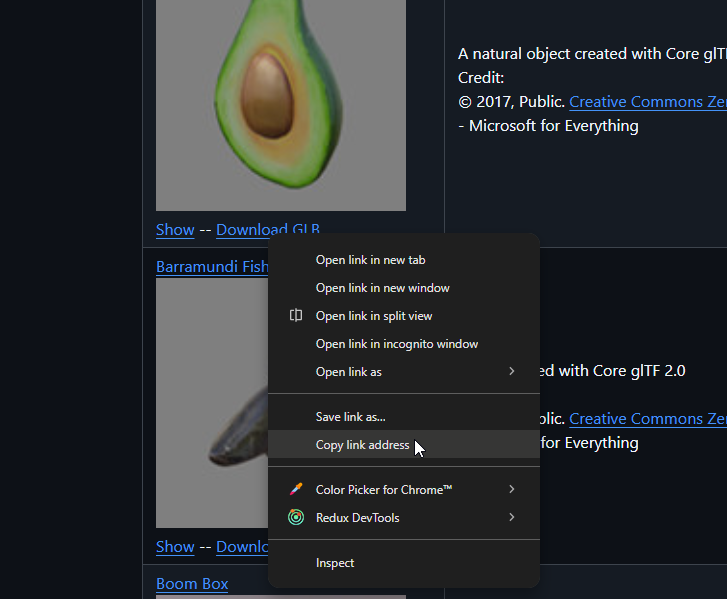
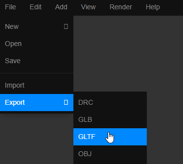

# Adding 3D Models to A-Frame
If you already have an [A-Frame world](./WorldbuildingCodeAlong.md), you can start adding 3D models to it! You can do something like [this](https://hytop.onrender.com/e/showcase-model/).

#### _NOTE: Official Documentation_
_[Click here for the official documentation from A-Frame about using 3D Models.](https://aframe.io/docs/1.8.0/introduction/models.html)_

## The Code
The code to add a model should be added between an `<a-scene>` opening tag and an `</a-scene>` closing tag. This code should be an an HTML file, like **index.html**. The code can look something like this:

```html
<a-assets>
  <a-asset-item id="model" src="scene.gltf" ></a-asset-item>
</a-assets>
<a-entity gltf-model="#model" scale="1 1 1" position="0 0 -5"></a-entity>
```

This will pull a local file named **scene.gltf** and place it at a position of `0 0 -5`. This is all the basic code, but... what about the model??

## The Model
There are many ways to find or create 3D models. To start, it may be easiest to use an existing model. [Click here for a bunch of free, open-source sample models.](https://github.com/KhronosGroup/glTF-Sample-Assets/blob/main/Models/Models.md)

### Using an Existing Model
In order to use one of these, you should right click the "Download GLB" link and select the "Copy link address" option:



Note that the option may say something different depending on the browser. From there, you can update the `src` attribute of the `a-asset-item` element to point to this URL, so it should look something like this:

```html
<a-asset-item src="https://raw.githubusercontent.com/KhronosGroup/glTF-Sample-Assets/main/Models/Avocado/glTF-Binary/Avocado.glb">
```

### Updating the Model's Placement
Depending on the model, you may want to put it in a different place or change its size. This can be done by altering the `a-entity` element, specifically the `scale` and `position` attributes. For example, to make the model bigger and further away, the code might be something like this:

```html
<a-entity gltf-model="#model" scale="5 5 5" position="0 0 -10"></a-entity>
```

Changing all those numbers will allow you to move and contort your model.

## Your Own Model
If you have a way to create your own model and host it somewhere online, you can follow the same steps as above - you just need to make sure you have a proper link to your model file. However, if you'd like to make a 3D model in browser right now, here is one way to do it.

[Click here to go to the three.js Editor.](https://threejs.org/editor) Play around with it to add some shapes and things. When you're satisfied, open the "File" menu in the upper left, then select "Export" and "GLTF" from the submenu:



Save your file locally. After download, you should be able to access this file directly from the browser (depending on your browser). Go back to HyTOP, open your browser downloads, click and drag the file, and update the `src` attribute of the `a-asset-item` element to be your new filename, and you should see your custom model!
