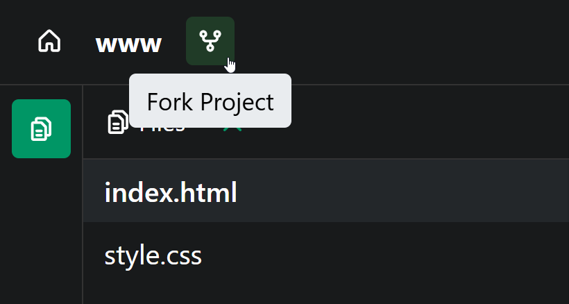
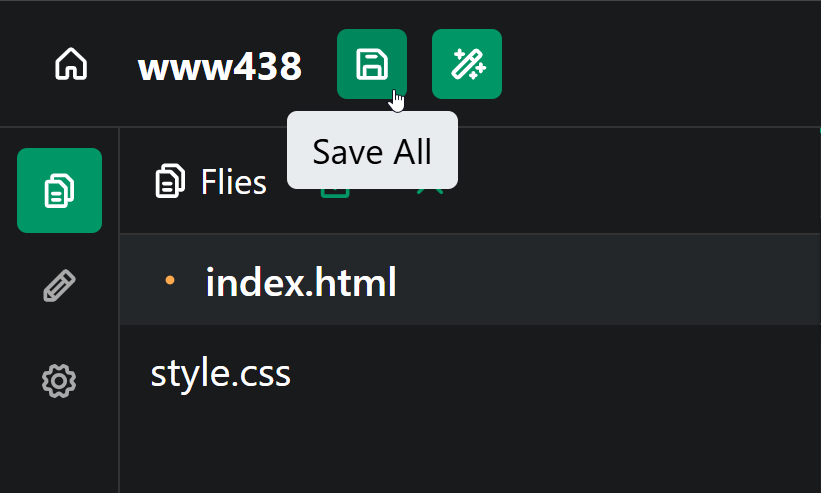

# Code-Along: Quiz About Me
In this activity, start building a quiz about yourself! Other people will be able to go to your website, and test their knowledge of YOU!

## Getting Started
You can start by forking [this template](https://hytop.onrender.com/e/www-jss) to jump right into the activity.



### Updating HTML
The starter project has some information on it... but it might not be accurate to you!

1. Open the **index.html** file by clicking it on the left
1. Find the `<h1>` part in the code
1. Change the name "Joseph" to your name (unless your name is Joseph!)
1. Find the `<p>` part under that
1. Change the blurb to be a unique fun fact about _you_

Make sure to save the project to see the changes update!



### Updating CSS
The starter project has some stylistic choices that are good, but you can make them your own!

1. Open the **style.css** file by clicking it on the left
1. Find the `background:` part in the code
1. Change the color to update your site's background!
1. Similarly, change the text color right under that with the `color:` part
1. Feel free to change the font as well
  - NOTE: There is a list of built-in fonts if you scroll down in the **style.css** file :)

### Updating JS
The starter project has a picture for the favorite animal, but you can change it!

1. Open the **script.js** file by clicking it on the left
1. Find the line that has a URL (starting with `https://`)
1. Open a new tab and find a new image
1. Right click the image and select the "Copy image link" option
1. Remove the old URL, and replace it by pasting your new URL with `Ctrl`+`V`

Now, the page should really be yours! It's time to start making the quiz.

## Displaying a Message
The first thing to do is make the `startQuiz` function display a message! Under the `function startQuiz() {` line, above the `}`, add a new `alert` statement:

1. `alert` keyword
2. Parentheses `()`
3. Quotation Marks `""` within the `()`
4. A message within the `""`
5. A semi-colon `;`

The code in the **script.js** file should look something like this!

```js
function startQuiz() {
  alert("Welcome to my quiz!");
}
```

## Commanding the Function: Already Done!
Code like this should already be within the **index.html** file:

```html
<button onclick="startQuiz()">Take a quiz about me!</button>
```

This connects the `startQuiz` function definition in the **script.js** file to the button on the page. Click the button to see it working!

>_**NOTE:** From here on out, every change will be in the **script.js** file!_

## Adding a Greeting
When welcoming someone to our quiz, we should ask for their name and then greet them. We can ask for their name using `prompt`, store their answer in a variable, and reply.

1. Under the `alert` (still above `}`), make a new line
1. Use a `prompt` to ask the user for their name
  1. `prompt` keyword
  1. Parentheses `()`
  1. Quotation Marks `""` in the `()`
  1. A question in the `""`

Save the project and click the button to see the prompt appear! Now we just have to save the answer.

1. Put your cursor to the _left_ of the `prompt` line
1. There, create a new variable named `name`
   1. `let`
   1. `name`
   1. `=`
1. Set the `name` variable to equal to the `prompt`

Now the user's name is stored in the `name` variable. We can use it to say hi!

1. Make a new line under the `prompt` (still above `}`)
1. Add an `alert` that says `"Hi, "`
1. Between the `(` and `)`, add `+ name` to add the `name` variable value to the end of the message

Save, click, and see what happens! It should respond based on the user input, saying "Hi, Person" for Person.

The added code should look something like this:

```js
let name = prompt("What is your name?");
alert("Hi, " + name);
```

## Asking a Quiz Question
Okay okay okay. We have added a lot of stuff, but what does any of this have to do with a quiz about me? NOTHING!

Well, it's time to change that! Let's ask our first quiz question :)

We can use `prompt` to ask the question, and create a new variable named `answer1` to store the user's answer.

1. `let` keyword
1. Variable name (`answer1`)
1. `=` Equals sign
1. `prompt` keyword
1. `()` Parentheses
1. `""` Quotation Marks within the `()`
1. Message within the `""`
1. `;` Semi-colon at the end

The added code should look something like this:

```js
let answer1 = prompt("What is my name?");
```

Click the button and see what happens - it asks the question, but doesn't do anything!

## Checking the Answer
Now that we have their answer, we should check to see **if** it's correct. If it is, they can increase their `points` by `1`.

We can do this with an `if` statement!

1. `if` keyword
2. `()` Parentheses
1. Condition inside of the `(` and `)`
   1. Left value `answer1`
   1. `==` Double equals
   1. Right value `"Joseph"` (unless your name is NOT Joseph)
1. `{}` Curly brackets
1. Body between `{` and `}` - display a message  
  1. `alert`, parentheses, quotes, `"CORRECT"` message!

The added code should look something like this:

```js
if (answer1 === "Joseph") {
  alert("CORRECT");
}
```

Now the quiz taker can start seeing how well they know you!

## Asking Another Question
Now, a quiz with one question isn't very interesting. Luckily, we can do basically the exact same thing we just did to add one more question!

1. Create a `prompt` asking the question
1. Store the users answer in a new variable
1. Use an `if` statement to check if their answer `==` the correct one
1. If it's correct, say so!

The added question might look something like this:

```js
let answer2 = prompt("Where was I born?");
if (answer2 === "Cleveland") {
  alert("CORRECT")
}
```

## Code
By the end of the activity, your code in the **script.js** file should look something like this:

```js
function startQuiz() {
  alert("Welcome!");

  let name = prompt("What is your name?");
  alert("Hi, " + name);

  let answer1 = prompt("What is my name?");

  if (answer1 === "Joseph") {
    alert("CORRECT")
  }

  let answer2 = prompt("Where was I born?");
  if (answer2 === "Cleveland") {
    alert("CORRECT")
  }
}
```

## Next Steps
Try adding more questions in the same way! [You can also use an `else` to display an "INCORRECT" message if the quiz taker gets a question wrong :)](https://www.w3schools.com/js/js_if_else.asp)

### Template Project
[Click here to make a fancy quiz.](TemplateProject.md)
